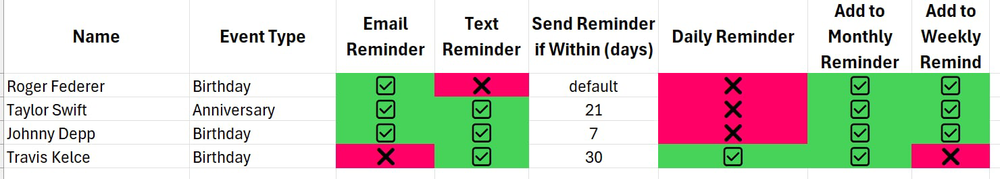
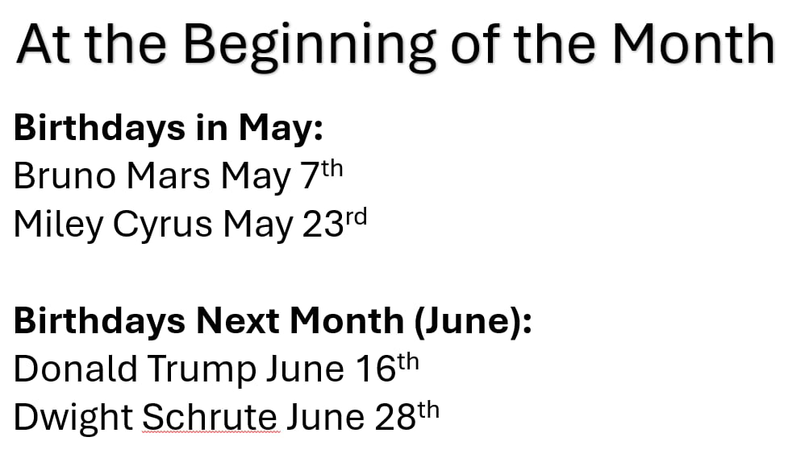

# Original mockups

## Event settings

## Monthly summary

## Daily countdown

Countdown values in the original example are illustrative and inconsistent; calculate them from stored dates.

## Product reference assets

The original reminder, People gift-notes, and Secret Santa direction is preserved in [`assets/I'm working on this.pdf`](../../assets/I'm%20working%20on%20this.pdf). The DrawNames feature reference used for the group-code, name-draw, wishlist, and reservation UX is [`assets/WebpageToPDF-drawnames___Features.pdf`](../../assets/WebpageToPDF-drawnames___Features.pdf).
